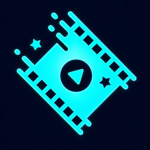

<div align="center">



# UAPlay — TrimUI Brick & Smart Pro (NextUI)

**Native Ukrainian-language video catalog for movies, TV series, cartoons, and anime on TrimUI handhelds running NextUI (`tg5040`)**

[](https://github.com/famiclone/UAPlay-trimui/actions/workflows/build.yml)
[](https://github.com/famiclone/UAPlay-trimui/releases/latest)
[](https://github.com/LoveRetro/NextUI)
[](#supported-devices)
[](#building-from-source)

[Українська](README.md) | **English**

</div>

---

**UAPlay** is a lightweight native C11 application built with **SDL2, OpenGL ES 2.0/3.0, libmpv, FFmpeg, and libcurl**, ported from [Small182/UAPlay-nx](https://github.com/Small182/UAPlay-nx) to **TrimUI Brick** and **TrimUI Smart Pro** handhelds running **NextUI**. It renders its UI and streams video natively without Chromium, WebKit, or TorrServer.

## Features

- **Ukrainian & English UI + TMDB Catalog:** Browse movies, TV series, cartoons, animated series, anime, and genre collections with country-of-origin filtering (excluding `RU` productions).
- **Pixel-Accurate 4:3 & 16:9 Layouts:** Automatically adapts to **TrimUI Brick** (`1024×768`, 5 poster columns) and **TrimUI Smart Pro** (`1280×720`, 6 poster columns).
- **Built-In Gamepad On-Screen Keyboard (`УКР` / `ENG`):** Full Ukrainian and English search input using the D-Pad or analog stick.
- **Native `libmpv` + `FFmpeg` (ARM64 NEON) Player:** Direct HLS/MP4 playback, voiceover/dub switching, audio & subtitle track selection, playback speed control, and HLS quality presets (`Auto` / `360p` / `480p` / `720p` / `1080p`, defaulting to `720p`).
- **NextUI Audio Integration:** Outputs audio via `ALSA`, working seamlessly with the built-in speaker, wired headphones, and NextUI's `audiomon` Bluetooth audio routing.
- **Favorites, Watch Later & Resume:** Persistent local library with timestamp, season, and episode resume plus automatic next-episode progression.
- **Offline SD Card Downloads:** Background download queue supporting direct MP4 and HLS (including OpenSSL AES-128 segment decryption) for offline viewing.
- **SubDL Subtitle Integration:** Search and download Ukrainian or English external subtitles directly from the player menu.
- **TrimUI Battery Indicator:** Reads real-time battery level from `/sys/class/power_supply/axp2202-battery/`.

---

## Supported Devices

| Device | NextUI Platform | Resolution | Poster Grid |
|---|---|---|---|
| **TrimUI Brick** (TG3040) | `tg5040` | `1024 × 768` (4:3) | 5 columns |
| **TrimUI Brick Pro** | `tg5040` | `1024 × 768` (4:3) | 5 columns |
| **TrimUI Smart Pro** (TG5040) | `tg5040` | `1280 × 720` (16:9) | 6 columns |

---

## Installation

### Option 1: Manual SD Card Installation
1. Download **`UAPlay.pak.zip`** from the [**Releases**](https://github.com/famiclone/UAPlay-trimui/releases/latest) page.
2. Extract its contents into `/mnt/SDCARD/Tools/tg5040/UAPlay.pak/` on your NextUI SD card so `launch.sh`, `pak.json`, and `uaplay` sit directly inside `UAPlay.pak/`:
   ```text
   SDCARD/
   └── Tools/
       └── tg5040/
           └── UAPlay.pak/
               ├── launch.sh
               ├── pak.json
               ├── icon.png
               ├── uaplay
               ├── lib/
               └── romfs/
   ```
3. Insert the SD card and launch **Tools → UAPlay** from NextUI.

### Option 2: NextUI Pak Store / Pak Manager
This repository includes a root [`pak.json`](pak.json) manifest (`"type": "TOOL"`, `"release_filename": "UAPlay.pak.zip"`) compatible with NextUI Pak managers using repository URL `https://github.com/famiclone/UAPlay-trimui`.

---

## TMDB & SubDL API Keys

### TMDB API Key (Live Catalog & Search)
If your build does not embed a TMDB key at compile time, place your free 32-character [TMDB API v3 Key](https://www.themoviedb.org/settings/api) (single line, no spaces) in either path on your SD card:
- `Tools/tg5040/UAPlay.pak/tmdb.key`, or
- `.userdata/tg5040/uaplay/tmdb.key`

*(Without `tmdb.key`, UAPlay falls back to bundled demo snapshots in `romfs/*.json`, while live catalog browsing and search require a key).*

### SubDL API Key (Optional External Subtitles)
Place your [SubDL API Key](https://subdl.com/api-doc) on a single line in `Tools/tg5040/UAPlay.pak/subdl.key` or `.userdata/tg5040/uaplay/subdl.key`, then press **X → Search subtitles on SubDL** during playback.

---

## Controls (TrimUI Layout)

Button labels match physical **TrimUI** face buttons (`A` = East, `B` = South, `X` = North, `Y` = West):

| Screen | Controls |
|---|---|
| **Catalog** | **D-Pad / Stick** — navigate; **A** — open; **B** — back; **L1 / R1** — switch top sections |
| **Search & Settings** | **X** — open search; **Y** — refresh catalog; **SELECT / MENU** — open/close settings |
| **Exit to NextUI** | **SELECT / MENU → Exit**, or **MENU + START** chord |
| **On-Screen Keyboard** | **D-Pad** — select key; **A** — type key; **X / L1** — backspace (`⌫`); **R1** — space; **Y / MENU** — toggle language (`УКР` / `ENG`); **START** — submit search; **B** — cancel |
| **Title Details** | **A** — pick source / resume; **X** — toggle favorite; **Y** — mark watched; **L2 / R2** — scroll synopsis |
| **Sources & Episodes** | **↑ / ↓** — select; **A** — play; **Y** — download for offline playback; **B** — back |
| **Video Player** | **A** — play / pause; **← / →** — seek ±10 s (**R1 + ← / →** — ±60 s); **↑ / ↓** — volume; **B** — close player |
| **Tracks & Quality** | **X** — subtitles; **Y** — audio / dubs; **SELECT / MENU** — video options (HLS preset, speed, subtitle size & delay) |

---

## User Data & Logs on SD Card

Updating `Tools/tg5040/UAPlay.pak/` preserves all user data stored under NextUI's `.userdata` directory:

| SD Card Path | Purpose |
|---|---|
| `/mnt/SDCARD/.userdata/tg5040/uaplay/library.tsv` | Favorites, Watch Later, Watch History, and playback resume progress |
| `/mnt/SDCARD/.userdata/tg5040/uaplay/settings.cfg` | Language, theme, accent color, enabled providers, HLS preset |
| `/mnt/SDCARD/.userdata/tg5040/uaplay/posters/` | Disk poster cache |
| `/mnt/SDCARD/.userdata/tg5040/uaplay/downloads/` | Downloaded offline videos |
| `/mnt/SDCARD/.userdata/tg5040/uaplay/subtitles/` | Cached SubDL subtitle files |
| `/mnt/SDCARD/.userdata/tg5040/logs/UAPlay.txt` | Latest runtime log |

---

## Building from Source

Cross-compilation runs inside a reproducible Docker image ([`Dockerfile.tg5040`](Dockerfile.tg5040)) built on `ghcr.io/loveretro/tg5040-toolchain:latest` (`aarch64-nextui-linux-gnu-gcc`, `GLIBC 2.28`, Cortex-A53), statically linking `libmpv 0.36.0`, `FFmpeg 6.1.2` (NEON + OpenSSL), `libass 0.17.3`, `harfbuzz 8.3.0`, `fribidi 1.0.15`, and `libcurl 8.10.1`.

```sh
# 1. Build the Docker toolchain image and compile dist/Tools/tg5040/UAPlay.pak + UAPlay.pak.zip
make

# 2. (Optional) Embed a TMDB v3 API key at compile time
make TMDB_API_KEY="your_32_char_tmdb_key"

# 3. Run host C parser & library regression tests
make test
```

---

## Credits & Legal Notice

- **Original UAPlay (Nintendo Switch):** [Small182/UAPlay-nx](https://github.com/Small182/UAPlay-nx) by [Small182](https://github.com/Small182).
- **Offline downloads & performance optimizations:** adapted from [antoxa2584x/UAPlay-vita](https://github.com/antoxa2584x/UAPlay-vita) by [antoxa2584x](https://github.com/antoxa2584x).
- **NextUI OS & Toolchain:** [LoveRetro/NextUI](https://github.com/LoveRetro/NextUI) (`tg5040-toolchain`).
- **Disclaimer:** UAPlay is an experimental homebrew project and is not affiliated with TrimUI, Nintendo, TMDB, or third-party streaming websites. No video content is bundled with this repository or application.
- **Metadata:** *This product uses the TMDB API but is not endorsed or certified by TMDB.*
- **Fonts:** Inter, DejaVu Sans, and Google Noto Sans (SIL Open Font License 1.1 / Bitstream Vera).
