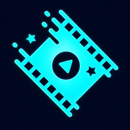

<div align="center">



# UAPlay — TrimUI Brick & Smart Pro (NextUI)

**Нативний україномовний відеокаталог фільмів, серіалів, мультфільмів та аніме для портативних консолей TrimUI з прошивкою NextUI (`tg5040`)**

[](https://github.com/famiclone/UAPlay-trimui/actions/workflows/build.yml)
[](https://github.com/famiclone/UAPlay-trimui/releases/latest)
[](https://github.com/LoveRetro/NextUI)
[](#підтримувані-пристрої)
[](#архітектура-та-збірка)

**Українська** | [English](README.en.md)

</div>

---

**UAPlay** — нативний C-застосунок на базі **SDL2, OpenGL ES 2.0/3.0, libmpv, FFmpeg та libcurl**, портований з [Small182/UAPlay-nx](https://github.com/Small182/UAPlay-nx) під кишенькові консолі **TrimUI Brick** та **TrimUI Smart Pro** під керуванням **NextUI**. Для інтерфейсу й відтворення відео не використовуються браузер, Chromium, WebKit або TorrServer.

## Можливості

- **Каталог українською мовою:** фільми, серіали, мультфільми, мультсеріали, аніме, тематичні добірки та фільтрація за країнами виробництва TMDB (зокрема виключення `RU`).
- **Адаптивний інтерфейс 1:1 піксель:** автоматичне підлаштування сітки постерів та шрифтів під екран **TrimUI Brick** (`1024×768`, 4:3, 5 колонок) та **TrimUI Smart Pro** (`1280×720`, 16:9, 6 колонок).
- **Вбудована екранна клавіатура (`УКР` / `ENG`):** швидкий пошук фільмів і серіалів за допомогою хрестовини або стіка без сенсорного екрана.
- **Нативний плеєр `libmpv` + `FFmpeg` (ARM64 NEON):** відтворення HLS/MP4 потоків, перемикання озвучок, аудіодоріжок і субтитрів, регулювання швидкості, гучності та якості HLS (`Авто` / `360p` / `480p` / `720p` / `1080p`, за замовчуванням `720p`).
- **Аудіо інтеграція з NextUI:** вивід звуку через `ALSA` (автоматично працює зі штатним динаміком, дротовими навушниками та Bluetooth-гарнітурами через `audiomon` NextUI).
- **Вибране, історія та продовження перегляду:** окремі вкладки «На майбутнє» та «Історія», запам'ятовування таймкоду, сезону й серії, автоперехід до наступної серії.
- **Офлайн-завантаження на SD-карту:** завантаження фільмів та серій у фоновому потоці (включно з розшифруванням HLS AES-128 через OpenSSL) для перегляду без Wi-Fi.
- **Субтитри SubDL:** пошук та завантаження українських і англійських субтитрів просто з меню плеєра.
- **Індикатор заряду TrimUI:** відображення рівня заряду батареї (`axp2202-battery`) у каталозі та оверлеї плеєра.
- **Оформлення:** темна і світла теми та набір акцентних кольорів.

---

## Підтримувані пристрої

| Пристрій | Платформа NextUI | Роздільна здатність | Сітка каталогу |
|---|---|---|---|
| **TrimUI Brick** (TG3040) | `tg5040` | `1024 × 768` (4:3) | 5 колонок постерів |
| **TrimUI Brick Pro** | `tg5040` | `1024 × 768` (4:3) | 5 колонок постерів |
| **TrimUI Smart Pro** (TG5040) | `tg5040` | `1280 × 720` (16:9) | 6 колонок постерів |

> Потрібна увімкнена мережа Wi-Fi у налаштуваннях NextUI для завантаження каталогу та онлайн-відтворення (офлайн-бібліотека й завантажені відео працюють без мережі).

---

## Встановлення

### Варіант 1: Ручне встановлення на SD-карту
1. Завантажте **`UAPlay.pak.zip`** зі сторінки [**Releases**](https://github.com/famiclone/UAPlay-trimui/releases/latest).
2. На SD-карті з **NextUI** створіть папку `/mnt/SDCARD/Tools/tg5040/UAPlay.pak/` і розпакуйте туди вміст архіву так, щоб `launch.sh`, `pak.json` та `uaplay` лежали безпосередньо всередині `UAPlay.pak/`:
   ```text
   SDCARD/
   └── Tools/
       └── tg5040/
           └── UAPlay.pak/
               ├── launch.sh
               ├── pak.json
               ├── icon.png
               ├── uaplay
               ├── lib/
               └── romfs/
   ```
3. Вставте SD-карту в консоль і відкрийте **Tools → UAPlay**.

### Варіант 2: Через NextUI Pak Store / Pak Manager
Репозиторій містить кореневий маніфест [`pak.json`](pak.json) стандарту NextUI (`"type": "TOOL"`, `"release_filename": "UAPlay.pak.zip"`), тому пакет сумісний із менеджерами пакетів NextUI при додаванні URL репозиторію `https://github.com/famiclone/UAPlay-trimui`.

---

## Налаштування ключів TMDB та SubDL

### Ключ TMDB (каталог і пошук)
Якщо ви використовуєте збірку без вмонтованого ключа TMDB, збережіть свій безкоштовний [TMDB API v3 Key](https://www.themoviedb.org/settings/api) (32 символи, одним рядком без пробілів) за будь-яким із шляхів на SD-карті:
- `Tools/tg5040/UAPlay.pak/tmdb.key` *(поруч із `launch.sh`)*, або
- `.userdata/tg5040/uaplay/tmdb.key`

*(Без `tmdb.key` застосунок відкриється з вбудованим демо-кешем із `romfs/*.json`, але онлайн-каталог і пошук потребуватимуть ключа).*

### Ключ SubDL (необов'язково, зовнішні субтитри)
1. Збережіть [SubDL API Key](https://subdl.com/api-doc) одним рядком у `Tools/tg5040/UAPlay.pak/subdl.key` або `.userdata/tg5040/uaplay/subdl.key`.
2. Під час перегляду натисніть **X → Шукати субтитри в SubDL** та оберіть український або англійський реліз.

---

## Керування на TrimUI Brick / Smart Pro

Позначення відповідають фізичним кнопкам **TrimUI** (`A` — праворуч, `B` — знизу, `X` — зверху, `Y` — ліворуч):

| Розділ | Кнопки та дії |
|---|---|
| **Каталог** | **D-Pad / Стік** — навігація; **A** — відкрити; **B** — назад; **L1 / R1** — перемикання розділів зверху |
| **Пошук і налаштування** | **X** — пошук; **Y** — оновити поточний каталог; **SELECT / MENU** — відкрити налаштування |
| **Вихід у NextUI** | **SELECT / MENU → Вихід**, або одночасно **MENU + START** |
| **Екранна клавіатура** | **D-Pad** — вибір клавіші; **A** — ввести символ; **X / L1** — стерти (`⌫`); **R1** — пробіл; **Y / MENU** — мова (`УКР` / `ENG`); **START** — шукати; **B** — скасувати |
| **Картка тайтлу** | **A** — вибрати джерело / продовжити перегляд; **X** — додати у вибране; **Y** — позначити переглянутим; **L2 / R2** — прокручування опису |
| **Джерела та серії** | **↑ / ↓** — вибір; **A** — відтворити; **Y** — завантажити на SD-карту; **B** — назад |
| **Плеєр** | **A** — пауза / пуск; **← / →** — ±10 с (**R1 + ← / →** — ±60 с); **↑ / ↓** — гучність; **B** — вийти з плеєра |
| **Доріжки й якість** | **X** — субтитри; **Y** — аудіодоріжки / озвучки; **SELECT / MENU** — параметри відео (якість HLS, швидкість, розмір і затримка субтитрів) |

---

## Джерела відео

Активні провайдери перемикаються в **Налаштування → Джерела** (вимкнені джерела не опитуються під час пошуку):

| Джерело | Контент |
|---|---|
| **UAFlix** | Фільми, серіали, мультфільми |
| **UASerials** | Серіали, мультсеріали, фільми українською |
| **Eneyida** | Фільми, серіали, мультфільми |
| **UAFilm** | Фільми та серіали |
| **UAKino** | Фільми, серіали, аніме (з підтримкою дзеркал) |
| **Mikai** | Аніме українською |
| **AnimeON** | Аніме українською |

> Доступність конкретного потоку, сезону або озвучки залежить від стороннього сайту та його CDN. UAPlay не зберігає медіафайли у своєму складі й не обходить регіональні чи авторизаційні блокування.

---

## Дані користувача та логи на SD-карті

Оновлення папки `Tools/tg5040/UAPlay.pak/` **не видаляє** вашу бібліотеку — усі користувацькі дані зберігаються окремо у стандартній директорії NextUI:

| Шлях на SD-карті | Призначення |
|---|---|
| `/mnt/SDCARD/.userdata/tg5040/uaplay/library.tsv` | Вибране, список «На майбутнє», історія та прогрес перегляду |
| `/mnt/SDCARD/.userdata/tg5040/uaplay/settings.cfg` | Мова інтерфейсу, тема, акцент, увімкнені джерела, якість HLS |
| `/mnt/SDCARD/.userdata/tg5040/uaplay/posters/` | Кеш завантажених постерів |
| `/mnt/SDCARD/.userdata/tg5040/uaplay/downloads/` | Відеофайли для офлайн-перегляду |
| `/mnt/SDCARD/.userdata/tg5040/uaplay/subtitles/` | Завантажені субтитри SubDL |
| `/mnt/SDCARD/.userdata/tg5040/logs/UAPlay.txt` | Лог останнього сеансу роботи |

---

## Архітектура та збірка з вихідного коду

Збірка повністю відтворювана через Docker ([`Dockerfile.tg5040`](Dockerfile.tg5040)) на базі офіційного крос-тулчейна `ghcr.io/loveretro/tg5040-toolchain:latest` (`aarch64-nextui-linux-gnu-gcc`, `GLIBC 2.28`, Cortex-A53). У бінарник статично влінковуються `libmpv 0.36.0`, `FFmpeg 6.1.2` (ARM64 NEON + OpenSSL), `libass 0.17.3`, `harfbuzz 8.3.0`, `fribidi 1.0.15` та `libcurl 8.10.1`.

```sh
# 1. Зібрати Docker-образ тулчейна та пакет dist/Tools/tg5040/UAPlay.pak + UAPlay.pak.zip
make

# 2. (Опціонально) Вмонтувати ключ TMDB під час компіляції
make TMDB_API_KEY="ваш_32_символьний_ключ_tmdb"

# 3. Запустити модульні та регресійні C-тести парсерів і бібліотеки на хості
make test
```

### GitHub Actions CI / Release
- Воркфлоу [`.github/workflows/build.yml`](.github/workflows/build.yml) запускає `make test` та крос-компіляцію `UAPlay.pak.zip` на кожен `push` і `pull_request`.
- Воркфлоу [`.github/workflows/release.yml`](.github/workflows/release.yml) автоматично публікує реліз із `UAPlay.pak.zip` та `SHA256SUMS.txt` при пуші тегу `v*` (наприклад, `git tag v0.5.1 && git push origin v0.5.1`).
- За бажанням додайте секрет репозиторію **`TMDB_API_KEY`** (*Settings → Secrets and variables → Actions*), щоб CI вбудовував ваш ключ у релізні бінарники.

---

## Подяка та правова інформація

- **Оригінальний застосунок UAPlay (Nintendo Switch):** [Small182/UAPlay-nx](https://github.com/Small182/UAPlay-nx) від [Small182](https://github.com/Small182).
- **Менеджер завантажень та оптимізації:** адаптовано з [antoxa2584x/UAPlay-vita](https://github.com/antoxa2584x/UAPlay-vita) від [antoxa2584x](https://github.com/antoxa2584x).
- **Платформа та тулчейн:** [LoveRetro/NextUI](https://github.com/LoveRetro/NextUI) (`tg5040-toolchain`).
- **Відмова від відповідальності:** UAPlay — неофіційний експериментальний проєкт. Жоден медіаконтент не входить до складу репозиторію чи пакета. Використовуйте лише контент, на перегляд якого маєте законне право.
- **Метадані:** *This product uses the TMDB API but is not endorsed or certified by TMDB.*
- **Шрифти:** Inter, DejaVu Sans та Google Noto Sans (SIL Open Font License 1.1 / Bitstream Vera).
